# Cours 7


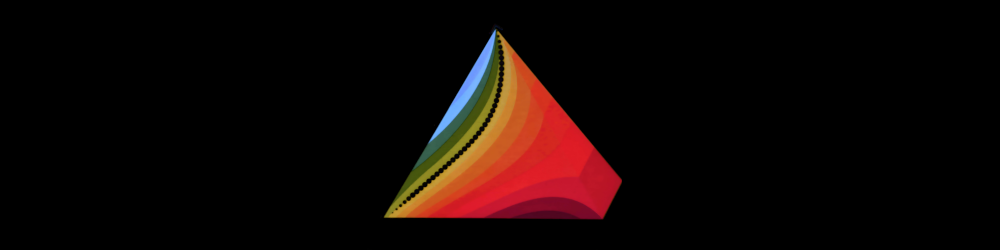

---

# Objectifs du cours

- **Coder pas à pas** : lancer le code à chaque étape
- Discrétiser un domaine 2D, représenter un champ par une matrice
- Modéliser un problème de diffusion en 2D
- Discrétiser les équations en 2D
- Implémenter la diffusion 2D en Python
- Conditions aux bords de Dirichlet
- Conditions de stabilité

---

# Coder pas à pas

**Quelques lignes → ▶ Run → vérifier → continuer**

- Une erreur se voit **tout de suite**, là où on vient d'écrire
- ✗ Tout écrire puis lancer : des erreurs mélangées, introuvables

→ Exemple : une tache de colorant dans un canal, en **8 étapes**

---

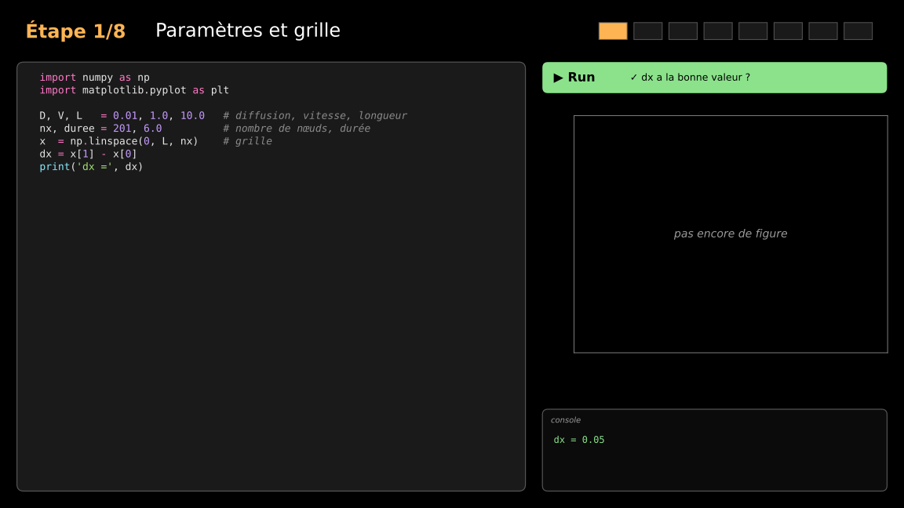

---

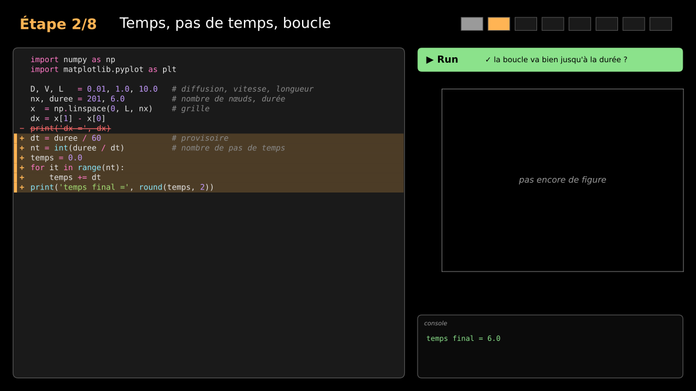

---

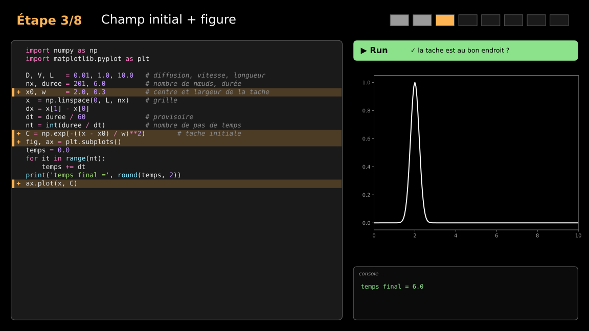

---

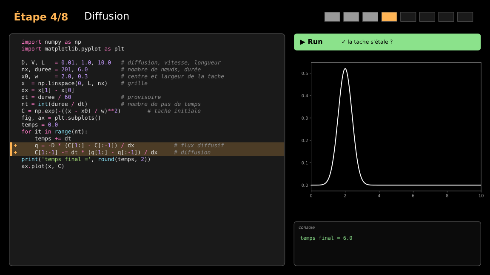

---

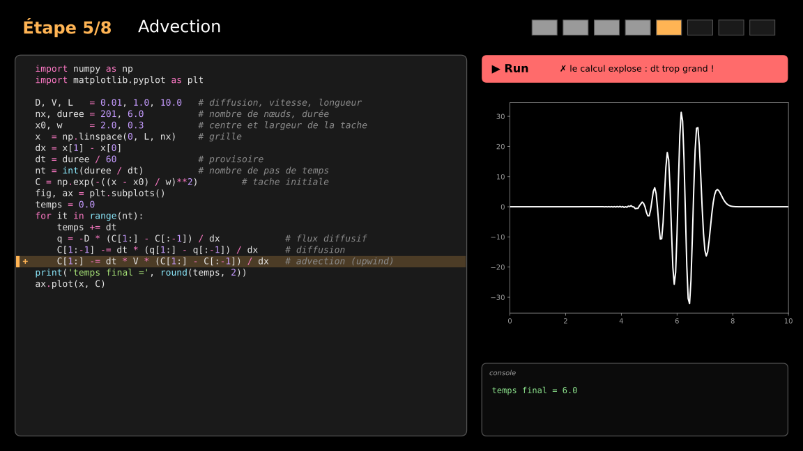

---

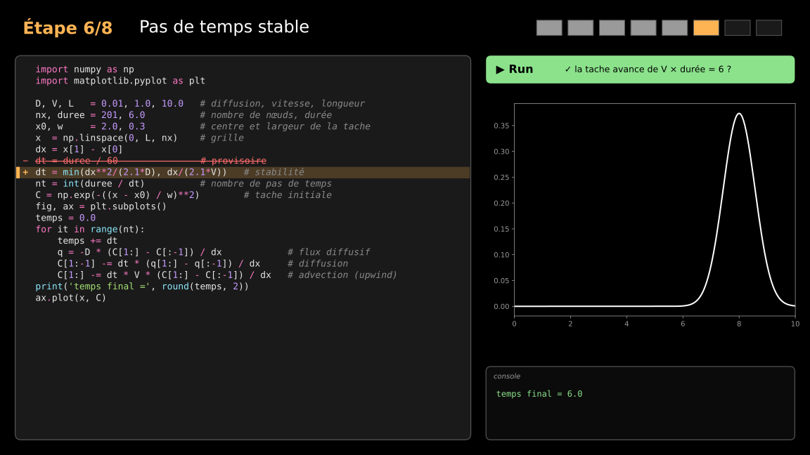

---

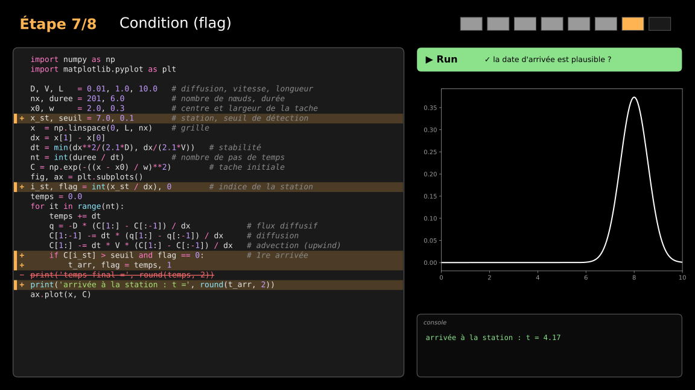

---

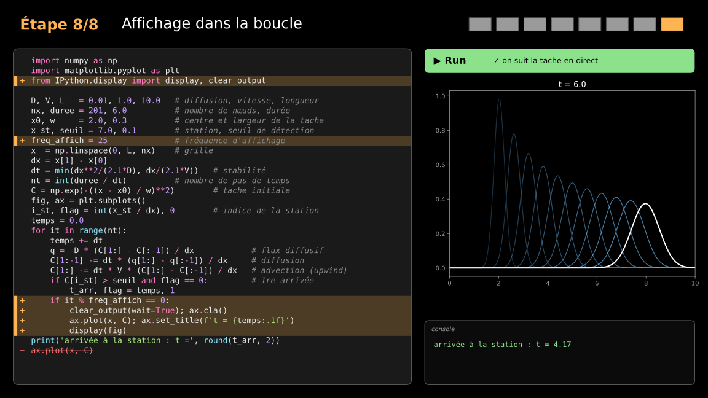

---

# Pourquoi modéliser en 2D ?

| | Exemple | Champ | Nœuds ($n = 100$ par direction) |
|---|---|---|---|
| **1D** | une rivière | vecteur `T[i]` | $100$ |
| **2D** | un polluant dans un lac | matrice `T[j, i]` | $10\,000$ |
| **3D** | le lac avec sa profondeur | tableau `T[k, j, i]` | $1\,000\,000$ |

→ Une dimension de plus : **plus réaliste**, mais **plus de mémoire et de calcul**.
→ On choisit la **plus petite dimension** qui décrit le phénomène.

---

# Discrétisation d'un domaine rectangulaire

Domaine $[0,L_x] \times [0,L_y]$, discrétisé comme en 1D, dans chaque direction :

```python
dx = Lx / (nx - 1) # pas d'espace en x
dy = Ly / (ny - 1) # pas d'espace en y

x = np.linspace(0, Lx, nx) # vecteur coordonnées en x
y = np.linspace(0, Ly, ny) # vecteur coordonnées en y

T = np.ones((ny,nx)) * Tinit # initialisation d'une temperature constante
```

---

# Grille 2D : nœuds et intervalles

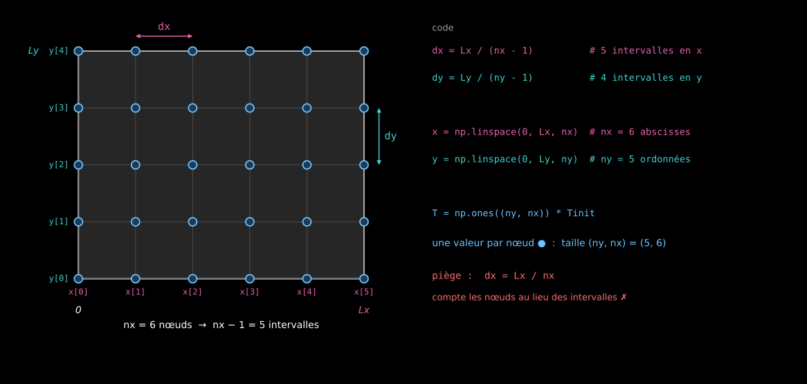

---

# Matrice représentant un champ 2D ($T$ ou $C$)


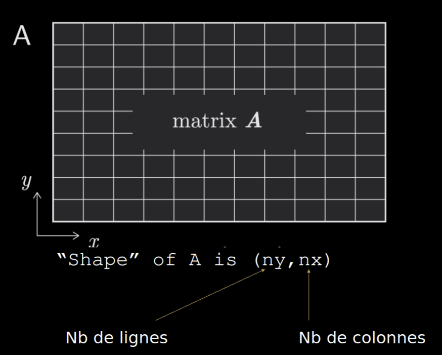

- Origine : coin **Sud-Ouest**
- **Lignes** ↔ axe 0 ↔ $y$  ·  **Colonnes** ↔ axe 1 ↔ $x$

---

# Matrice ou carte ? L'affichage avec `imshow`

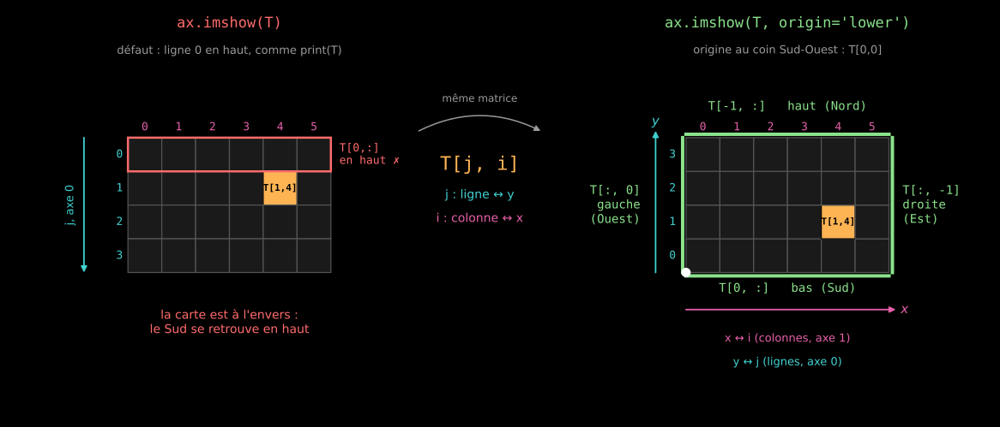

---

# Équation de diffusion en 2D

$$\frac{\partial T}{\partial t} = - \left( \frac{\partial q_x}{\partial x} + \frac{\partial q_y}{\partial y} \right),$$

$$q_x = -D \frac{\partial T}{\partial x}, \qquad q_y = -D \frac{\partial T}{\partial y}.$$

→ Comme en 1D, mais avec **deux flux** : $q_x$ dérivé selon $x$, $q_y$ selon $y$.

---

# Approximation des dérivées partielles en 2D

| Dérivée | Code | Taille |
|---|---|---|
| $\partial T / \partial x$ (axe 1, colonnes) | `(T[:,1:] - T[:,:-1]) / dx` | `(ny, nx-1)` |
| $\partial T / \partial y$ (axe 0, lignes) | `(T[1:,:] - T[:-1,:]) / dy` | `(ny-1, nx)` |

→ Chaque dérivée **perd un nœud dans sa direction** : les deux tailles diffèrent.

---

# Discrétisation des flux $q_x$ et $q_y$ : suivre les tailles

| Tableau | Taille |
|---|---|
| `T` | `(ny, nx)` |
| `qx`, `qy` | `(ny, nx-1)`, `(ny-1, nx)` |
| `dqxdx`, `dqydy` | `(ny, nx-2)`, `(ny-2, nx)` ✗ incompatibles |
| `dTdt` | `(ny-2, nx-2)` ✓ après troncature |

→ Couper la 1re et la dernière **ligne** de `dqxdx`, **colonne** de `dqydy`.
→ `dTdt` met à jour les **nœuds intérieurs** `T[1:-1, 1:-1]`.

---

# Illustration graphique

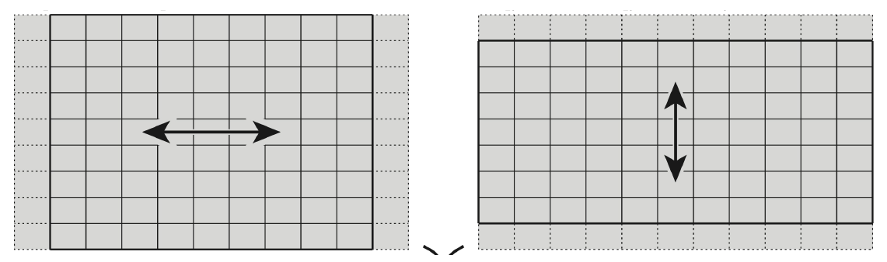

```python
qx = -D * (T[:,1:] - T[:,:-1]) / dx        qy = -D * (T[1:,:] - T[:-1,:]) / dy
dqxdx = (qx[:,1:] - qx[:,:-1]) / dx        dqydy = (qy[1:,:] - qy[:-1,:]) / dy
```

```
taille        (ny,nx-2)                               (ny-2,nx)
```

---

# Troncature pour assurer la compatibilité

```python
qx = -D * (T[:,1:] - T[:,:-1]) / dx            qy = -D * (T[1:,:] - T[:-1,:]) / dy
dqxdx = (qx[:,1:] - qx[:,:-1]) / dx            dqydy = (qy[1:,:] - qy[:-1,:]) / dy

taille        (ny,nx-2)                               (ny-2,nx)
```


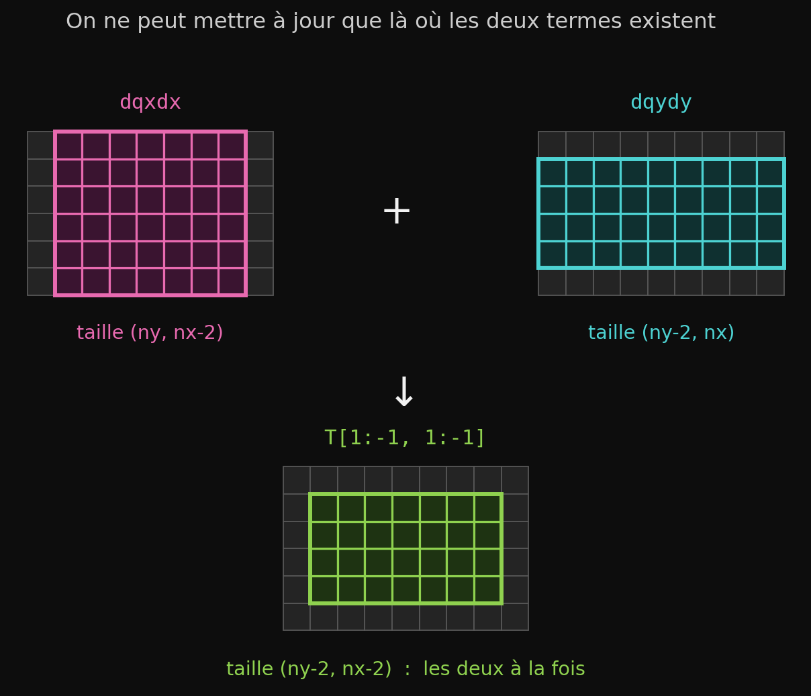

```python
dTdt = - ( dqxdx[1:-1,:] + dqydy[:,1:-1] )     # taille (ny-2,nx-2)
T[1:-1, 1:-1] += dTdt * dt                     # mise à jour
```

---

# Condition de stabilité


Stable seulement si $dt$ est assez petit. En 2D : **le plus petit pas d'espace**, et **4.1** au lieu de 2.1.

$$ dt_\mathrm{diff} = \frac{\min(dx,dy)^2}{4.1 \times D}, \qquad
dt = \min \left( dt_\mathrm{max}, \ dt_\mathrm{diff} \right)$$

```python
dt_diff = min(dx, dy)**2 / (4.1 * D)  # contrainte de la diffusion 2D
dt      = min(dt_max, dt_diff)        # pas de temps retenu
```

→ Grille 2 × plus fine ⇒ $dt$ 4 × plus petit.

---

# Conditions aux bords de Dirichlet

Un rectangle : **quatre bords** à imposer, dans la boucle, après la mise à jour.

```python
T[0, :]  = T_bas     # 1er ligne
T[-1, :] = T_haut    # derniere ligne
T[:, 0]  = T_gauche  # 1er colonne
T[:, -1] = T_droit   # derniere colonne
```

---

<!-- _class: invert pratique -->

# La séance pratique

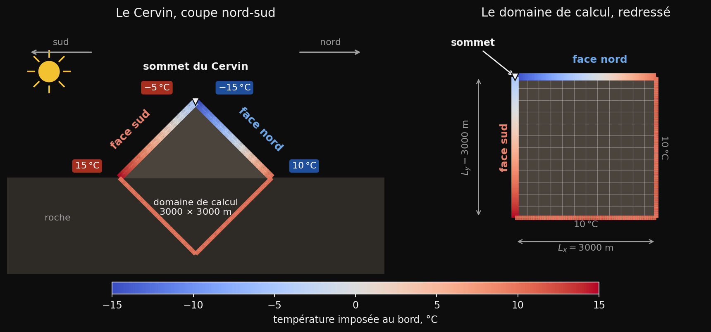

**Que veut-on modéliser ?** — la température à l'intérieur d'une montagne, et le recul du permafrost sous le réchauffement.

**Ce qui est nouveau**
- le passage à la **2D** : une matrice `(ny, nx)`
- **deux flux**, $q_x$ et $q_y$, et la troncature qui les rend compatibles
- $dt_\mathrm{diff} = \min(dx,dy)^2/(4.1\,D)$, plus sévère qu'en 1D
- Dirichlet sur les **quatre** bords

**L'exercice** — suivre la migration de l'isotherme $0\,°$C, et en déduire l'étendue des pentes qui se déstabilisent.

**Le tutoriel** — une figure 2D interactive, le piège classique après `ax.cla()`, et les lignes de niveau avec `contour`.
